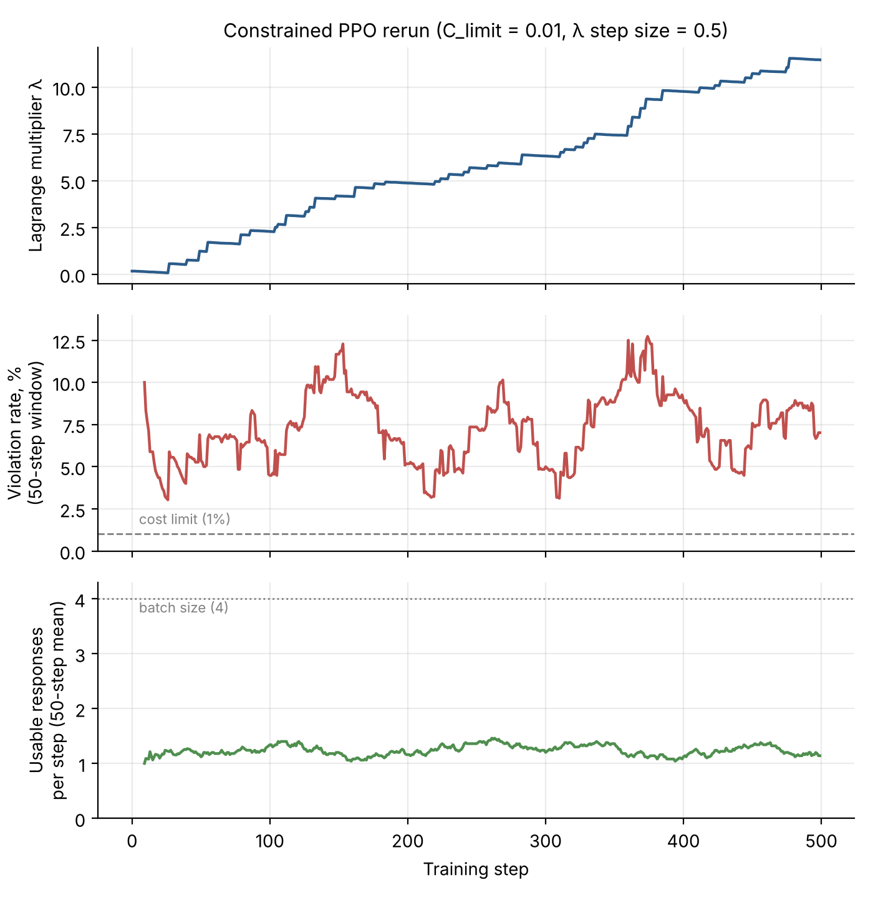

# cmdp-emotional-support-pilot

**Paper:** [cmdp_emotional_support_pilot.pdf](cmdp_emotional_support_pilot.pdf) (manuscript, 2026)

*Lagrangian-Constrained PPO with an LLM Safety-Cost Oracle for Emotional-Support Dialogue: A Small-Model Pilot Study*

**Summary.** TinyLlama-1.1B-Chat → rejection fine-tuning (RFT) → unconstrained vs.
Lagrangian-constrained PPO, with a live GPT-4o-mini safety-cost oracle, evaluated on 100
held-out ESConv prompts. Result: **no significant difference between systems** (Fisher's
exact p ≥ 0.36). In the original run the constraint was largely inactive (λ ≤ 0.04)
because the cost limit (0.30) sat above the policy's violation rate.

**Follow-up (November 2026).** A rerun with the constraint forced to engage (λ rose
from 0 to 11.5) still did not reduce violations. Per-step logs show the real bottleneck
was a starved learning signal, not the threshold. See
[Follow-up rerun](#follow-up-rerun-with-an-active-constraint-november-2026) below.

> ⚠️ **Not for deployment.** These are research artifacts. They produce short,
> low-quality and sometimes unsafe responses and must not be used with people
> seeking mental health support.

## Repository contents

**Notebooks**
- `rft.ipynb`: RFT, candidate generation (500 prompts × 3) and LoRA fine-tuning
- `ppo unconstrain.ipynb` / `ppo constrain.ipynb`: critic-free PPO (`USE_CONSTRAINT = False / True`)
- `evaluation v1.ipynb`: first evaluation run (single attempt per prompt)
- `evaluation v2.ipynb`: main evaluation (retry on failure, up to 5 attempts)
- `diagnostic-run.ipynb`: untuned base-model failure diagnostic (19/30)
- `ppo_constrained_rerun_c001.ipynb`: follow-up constrained PPO rerun (C_limit = 0.01,
  λ step size = 0.5) with per-step logging; includes a hash check confirming the same
  RFT adapter and reward model as the original runs

**Results**
- `eval_results_latest.zip`, `eval_results_v2_latest.zip`: per-response evaluation outputs (v1, v2)
- `ppo_constrained_c001_steps.csv`: per-step log of the rerun (valid responses, reward,
  cost, λ before and after the update, mean response length)

**Figures**
- `figure1_pipeline.pdf`: pipeline overview
- `figure2_lambda.png`: λ in the original constrained run
- `figure3_violations_ci.pdf`: test-set violation rates with Wilson 95% CIs
- `figure4_rerun_dynamics.png`: rerun dynamics (λ, rolling violation rate, usable responses per step)

## Follow-up: rerun with an active constraint (November 2026)

In the original constrained run, the cost limit (C_limit = 0.30) sat above the policy's
training-time violation rate, so the Lagrange multiplier almost never moved. To test
whether the threshold explained the null result, I reran constrained PPO with the
constraint forced to engage.

**What changed.** Everything else was identical: same RFT starting adapter and reward
model (verified by file hash), same data order, same hyperparameters.

| Setting | Original | Rerun |
|---|---|---|
| Cost limit (C_limit) | 0.30 | 0.01 |
| Dual learning rate (λ step size) | 0.05 | 0.5 |
| Random seed | not fixed | fixed (123) |
| Logging | checkpoints only | every step |

**Result.** The constraint engaged fully (λ rose from 0 to 11.5), but the training-time
violation rate did not change.

| Training steps | Usable responses | Violations | Rate |
|---|---|---|---|
| 0–249 | 310 | 22 | 7.1% |
| 250–499 | 307 | 22 | 7.2% |

Fisher's exact test, first vs. second half: p = 1.0. Mean reward and response length were
also flat across training.

**Diagnosis from the per-step log.**
- 69% of generations (1,383 of 2,000) were empty or under three words after cleaning,
  mostly echoes of the prompt template, and were discarded.
- 117 of 500 steps had no usable response and 196 had exactly one. With advantages
  normalized within each batch, a single response gives an advantage of zero, so those
  steps produced no learning signal.
- Only 30 of 500 updates contained both a flagged and a clean response, the only updates
  where the safety penalty could change which response was preferred.

**Conclusion.** The threshold was a real configuration error, but it was not the cause of
the null result. The bottleneck was a starved learning signal. Likely fixes for future
work: give degenerate outputs a low reward instead of discarding them, and sample several
responses per prompt so every update contains a comparison.

*These are training-time oracle numbers. The rerun policy has not been scored on the
100-prompt test set, so it is not part of Table 3 in the paper.*

## Reproducing
1. Download ESConv from https://github.com/thu-coai/Emotional-Support-Conversation
   (academic research use only) and build the (context, strategy, response) triples.
   The preprocessing script is not yet in this repository; the processed triples are
   available on request.
2. Model checkpoints and the Kaggle dataset are available on request.
3. Set `OPENAI_API_KEY` as an environment variable or Kaggle Secret.
4. Hardware: one NVIDIA T4 (16 GB). Each PPO run takes about 3 h. Total API cost was
   about US$0.42 for the original study and US$0.016 for the rerun.

Generation in the original runs and evaluation is unseeded, so re-running them will give
somewhat different numbers. The rerun fixes its seed.

## License
Code: MIT. ESConv and Counsel Chat remain under their original terms.
